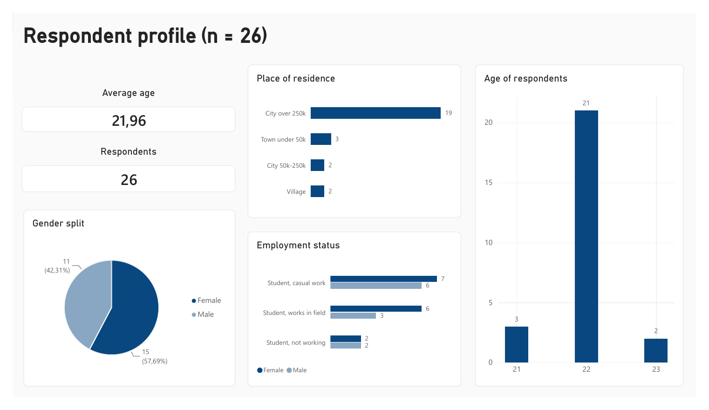
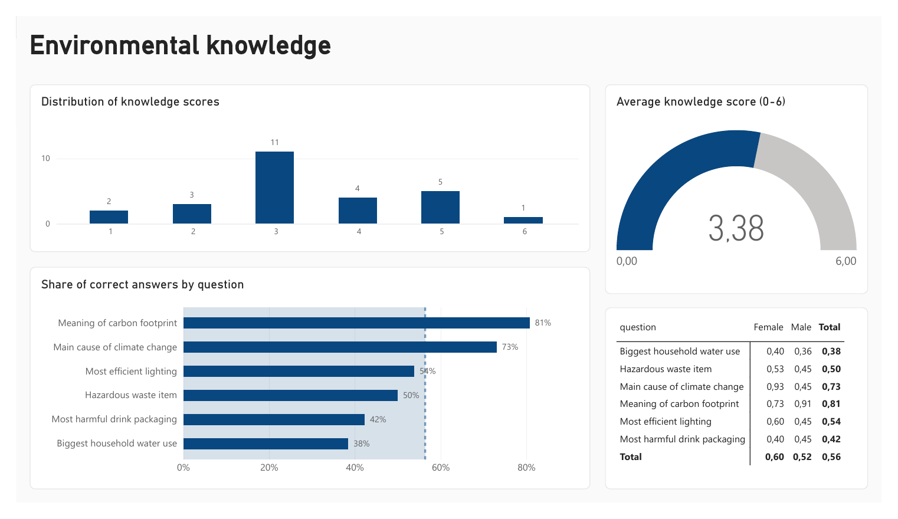
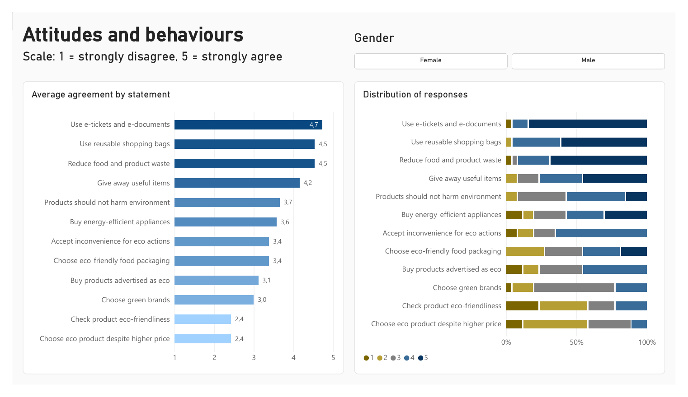
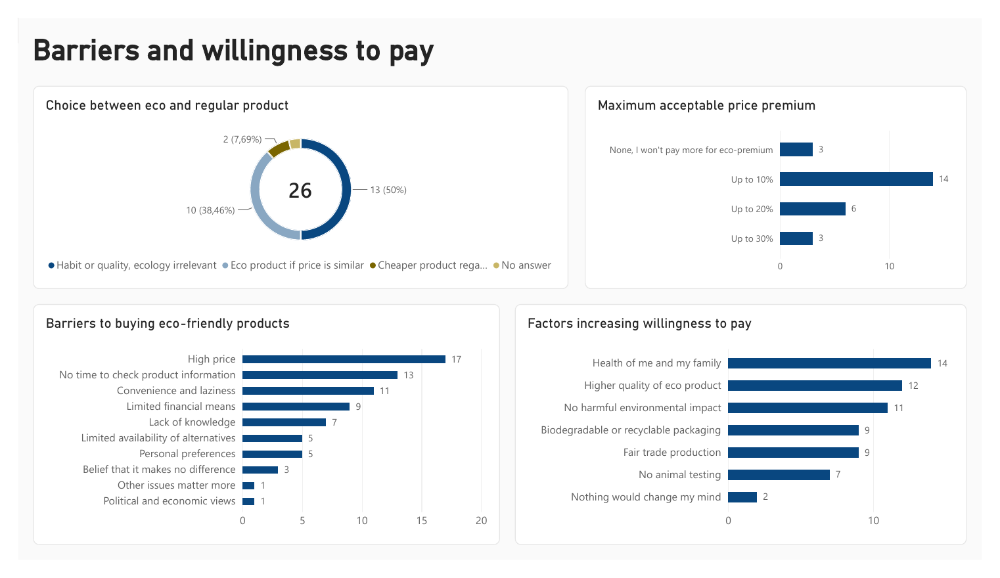
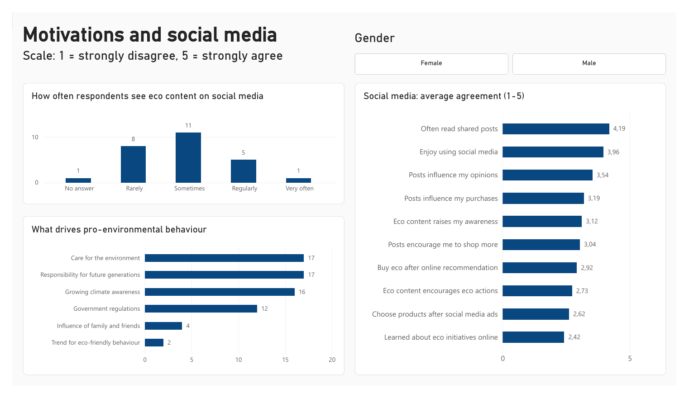

## Pro-Environmental Attitudes and Behaviours: Survey Analysis (Power BI)
Exploratory data analysis (EDA) of a student survey, presented as an interactive Power BI report.
>University assignment. The raw survey responses are not published in this repository (see Data and privacy).
### Project overview
The goal of this project was to analyse responses collected with Google Forms from a student group (n = 26) and to present the results in a Power BI report.

The survey covers environmental knowledge, pro-environmental attitudes and consumer behaviour, willingness to pay for eco-friendly products, personal values, trust in science, the role of social media and perceived stress. The analysis describes the profile of the group and explores how knowledge, attitudes, price sensitivity and social media use relate to each other.
### Dashboard

The report has six pages.

| Page | What it shows |
|---|---|
| Respondent profile | Group structure: gender, age, employment status, place of residence |
| Environmental knowledge | Distribution of knowledge scores (0-6), average score, share of correct answers per question, and a gender comparison |
| Attitudes and behaviours | Average agreement and distribution of answers for 12 statements (scale 1-5) |
| Barriers and willingness to pay | Barriers to buying eco-friendly products, acceptable price premium, factors increasing willingness to pay |
| Motivations and social media | Drivers of pro-environmental behaviour, frequency of eco content on social media, social media statements |
| Relationships | Knowledge, social media influence and price premium compared with the attitude index, plus a comparison by gender |

### Screenshots








A PDF version of the report is available in [`report/`](report/).

### Key findings

**Sample.** 26 students (15 women, 11 men), average age 22, mostly living in cities over 250k inhabitants (19 of 26). Half of them combine studies with casual work (13).

1. **Environmental knowledge is moderate.** The average score was 3.4 out of 6 and only one respondent answered all questions correctly. The best-known topics were the carbon footprint (81% correct) and the cause of climate change (73%). The weakest were household water use (38%) and the impact of drink packaging (42%). Women answered the climate-cause question correctly more often than men (93% vs 45%), and the carbon footprint question too (91% vs 73%).
2. **Low-effort habits are common, costly choices are not.** The highest-rated behaviours were using e-tickets and e-documents (4.7 out of 5), reusable shopping bags (4.5) and reducing waste (4.5). The lowest were choosing an eco product despite a higher price (2.4) and checking whether a product is eco-friendly (2.4).
3. **Price is the main barrier.** "High price" was the most frequent barrier (17 mentions), followed by lack of time to check product information (13) and convenience (11). 14 of 26 respondents would pay at most 10% more for an eco-friendly product and only 3 would pay up to 30%.
4. **Eco choice depends on price parity.** 10 respondents would choose the eco product if the price were similar, while 13 would stick to habit or quality regardless of ecology.
5. **Motivations are values-based.** The most frequent drivers of pro-environmental behaviour were care for the environment (17), responsibility for future generations (17) and growing climate awareness (16). Government regulations were named by 12 respondents, family and friends by only 4.
6. **Social media is widely used but has limited eco impact.** Respondents often read shared posts (4.2 out of 5), but most see eco content only sometimes (11) or rarely (8). Posts influence their opinions (3.5) more than eco actions (2.7) or eco purchases (2.9).
### Methodology
Data preparation was done in Power Query:

- Renamed 63 survey columns to short English names grouped by topic (`know_`, `att_`, `val_`, `sci_`, `sm_`, `ps_`); the full mapping is in [`data/data_dictionary.csv`](data/data_dictionary.csv).
- Fixed typos and unified inconsistent answer labels.
- Converted Likert answers to numbers (1 = strongly disagree ... 5 = strongly agree). Stress items use 1 = never ... 5 = very often.
- Reverse-scored the four positively worded stress items (6 minus value) and calculated a total stress score (10-50).
- Calculated a **knowledge score** (0-6) by comparing answers with an answer key; "don't know" counts as incorrect.
- Calculated **age** (2025 minus year of birth), an **attitude index** (mean of 12 statements) and a **social media eco influence** index (mean of 4 statements).
- Split multiple-choice answers (up to 3 options) into separate rows, which gives the tables `barriers_long`, `wtp_long` and `drivers_long`.
- Unpivoted knowledge, attitude and social media questions into long tables for charting.
- Translated answer labels into English.
- Removed columns that could identify respondents (timestamp, year of birth, weight, height).

Data model: `survey_scores` (one row per respondent) is related one-to-many on `respondent_id` to the long tables.
### Limitations
- Small sample (n = 26) from a single class group, so results are descriptive and cannot be generalised.
- Self-reported answers, which may be affected by social desirability.
- Narrow age range (21-23), small subgroups and no statistical significance testing.
- Multiple-choice questions allowed up to three answers, so counts refer to responses, not respondents.
- Questions on personal values, trust in science and perceived stress were prepared in the data but are not visualised in this version of the dashboard.

### Data and privacy
The survey data come from an in-class exercise and contain answers of individual students. To protect their privacy, the raw file and the Power BI file (which embeds the data) are **not included** in this repository. Identifying columns were removed during preparation. The repository contains the dashboard screenshots, a PDF export of the report and the data dictionary.

### Tools
Power BI Desktop (Power Query, data modelling, report design) and Excel (source file).

### Repository structure
```
├── README.md
├── screenshots/        # dashboard pages
├── report/             # PDF export of the Power BI report
└── data/
    └── data_dictionary.csv
```

### Author
Bartosz Malinowski
