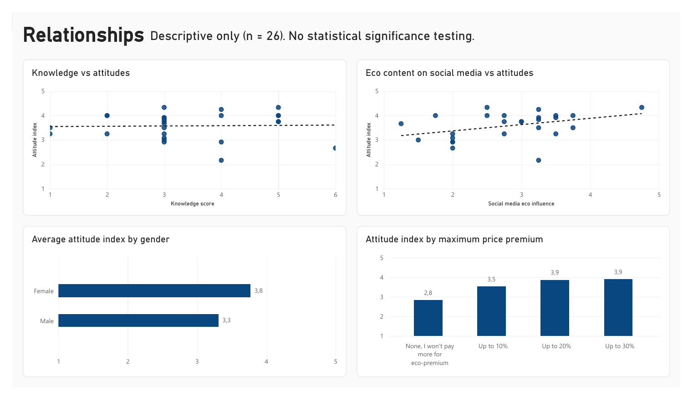

## Pro-Environmental Attitudes and Behaviours: Survey Analysis (Power BI)
Exploratory data analysis (EDA) of a student survey, presented as an interactive Power BI report.
>University assignment. The raw survey responses are not published in this repository (see Data and privacy).
### Project overview
The goal of this project was to analyse responses collected with Google Forms from a student group (n = 26) and to present the results in a Power BI report.

The survey covers environmental knowledge, pro-environmental attitudes and consumer behaviour, willingness to pay for eco-friendly products, personal values, trust in science, the role of social media and perceived stress. The analysis describes the profile of the group and explores how knowledge, attitudes, price sensitivity and social media use relate to each other.
### Dashboard

The report has six pages.

| Page | What it shows |
|---|---|
| Respondent profile | Group structure: gender, age, employment status, place of residence |
| Environmental knowledge | Distribution of knowledge scores (0-6), average score, share of correct answers per question, and a gender comparison |
| Attitudes and behaviours | Average agreement and distribution of answers for 12 statements (scale 1-5) |
| Barriers and willingness to pay | Barriers to buying eco-friendly products, acceptable price premium, factors increasing willingness to pay |
| Motivations and social media | Drivers of pro-environmental behaviour, frequency of eco content on social media, social media statements |
| Relationships | Knowledge, social media influence and price premium compared with the attitude index, plus a comparison by gender |

### Screenshots

A PDF version of the report is available in [`report/`](report/).
### Key findings
### Methodology
### Data and privacy
### Tools
Power BI Desktop (Power Query, data modelling, report design) and Excel (source file).
### Repository structure

### Author
Bartosz Malinowski
